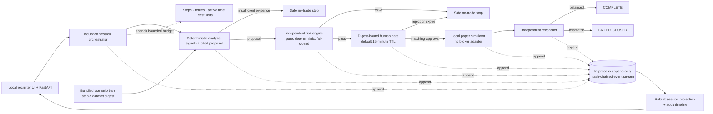
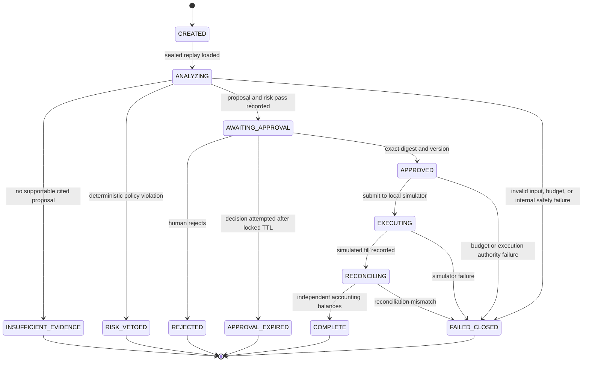

# RiskLedger

**A deterministic, bounded, event-sourced paper-trading replay for reviewing safety-critical AI workflow design.**

RiskLedger replays bundled market scenarios, produces an evidence-cited trade proposal, applies an independent deterministic risk policy, pauses for a human decision, and—only after an exact approval match—creates a simulated fill and independently reconciles the ledger.

> **Safety scope:** this repository has no live broker integration, broker credentials, real-money path, or outbound market-data dependency. Every fill is generated by `LOCAL_PAPER_SIMULATOR`. It is a software-engineering demonstration, not financial advice, and it makes no performance or profit claim.

## Why this project exists

The interesting problem is not generating a trade. It is making every no-trade outcome safe, visible, and auditable.

| Design pressure | RiskLedger's answer |
|---|---|
| Reproducibility | Bundled, hashed scenarios; fixed decision time; `Decimal` arithmetic; deterministic analysis, risk, fill, and reconciliation |
| Look-ahead bias | Analysis can read only bars at or before the decision boundary; the next bar is reserved for simulated execution |
| Runaway automation | Hard budgets cover steps, retries, active elapsed time, and cost units; exhaustion stops closed |
| Proposer self-approval | Proposal generation and risk evaluation are separate; the deterministic risk engine has an unconditional veto |
| Stale human intent | Approval uses a locked TTL (15 minutes by default) and is bound to the exact server-issued digest and expected event-stream version |
| Silent accounting drift | An independent reconciler recomputes cash and positions after the simulated fill |
| Mutable history | Session state is rebuilt from append-only, hash-chained events with optimistic version checks |

## Architecture



Analyzer logic reads only `analysis_bars`; changing the later execution bar cannot change the proposal. The risk engine evaluates the immutable proposal and portfolio snapshot independently. The simulator cannot run from a vetoed, rejected, expired, or insufficient-evidence session. Completion means both a simulated fill and a balanced reconciliation—not merely an order attempt.

## Session state machine

`AWAITING_APPROVAL` is the only state in which a human command can advance a session. A stale event-stream version or mismatched digest rejects the command and leaves the session unchanged.



Terminal meanings:

- `COMPLETE`: a paper fill exists and independent reconciliation balanced.
- `RISK_VETOED`, `INSUFFICIENT_EVIDENCE`, and `REJECTED`: successful safe no-trade outcomes with `HALTED` outcome.
- `APPROVAL_EXPIRED`: a late human command records a bounded no-fill stop.
- `FAILED_CLOSED`: prevents any further automation. A post-fill reconciliation failure retains its simulated artifacts for audit but never becomes `COMPLETE`.

## Run locally

Prerequisites: Python 3.12 and [uv](https://docs.astral.sh/uv/).

```bash
uv sync --locked --all-groups
uv run uvicorn risk_ledger.main:app --host 127.0.0.1 --port 8000 --reload
```

Open [http://127.0.0.1:8000](http://127.0.0.1:8000). No API key, brokerage account, environment file, or network data feed is required.

The equivalent shortcuts are:

```bash
make sync
make run
```

### Run with Docker

```bash
docker build --tag risk-ledger:local .
docker run --rm --read-only --tmpfs /tmp \
  --publish 127.0.0.1:8000:8000 risk-ledger:local
```

The runtime image uses Python 3.12, contains only production dependencies, and runs as an unprivileged user. Binding the published port to `127.0.0.1` preserves the local-demo boundary.

## Five-minute demo

1. Start with **Insufficient evidence**. The analyzer declines to manufacture a proposal, and the session halts with no fill.
2. Run **Stale price veto**. The independent risk engine emits a stable violation and the approval path remains unavailable.
3. Run **Steady rise**. Inspect the source bar IDs cited by each signal, the proposal, risk decision, and approval digest.
4. Reject one session to show that a human can always stop a risk-passed proposal.
5. Start a fresh steady-rise session, approve the exact digest, use the audit lens to inspect the hash-chained timeline, and export the complete audit evidence as JSON.

The same scenario and locked inputs reproduce the same domain decisions. Operational identifiers such as a new session ID may differ between runs.

## Bundled scenarios

| Scenario ID | Expected terminal path | What it demonstrates |
|---|---|---|
| `steady-rise` | `AWAITING_APPROVAL` → `COMPLETE` or `REJECTED` | Evidence citations, human gate, simulated fill, reconciliation |
| `stale-price-veto` | `RISK_VETOED` | Independent, non-overridable stale-data policy |
| `insufficient-evidence` | `INSUFFICIENT_EVIDENCE` | The analyzer can stop without proposing a trade |

These are synthetic replay fixtures for deterministic testing. They are not forecasts, recommendations, or evidence of strategy profitability.

## HTTP surface

All responses use a consistent `success`/`data` or `success`/`error` envelope.

| Method | Route | Purpose |
|---|---|---|
| `GET` | `/` | Local interactive demo |
| `GET` | `/api/health` | Health and explicit `PAPER_ONLY` mode |
| `GET` | `/api/scenarios` | Bundled scenario metadata |
| `POST` | `/api/sessions` | Start one bounded replay session |
| `GET` | `/api/sessions/{session_id}` | Read the rebuilt projection and audit events |
| `POST` | `/api/sessions/{session_id}/approve` | Record a human decision bound to digest and expected version |
| `POST` | `/api/sessions/{session_id}/reject` | Halt a risk-passed proposal without execution |

Mutation requests from the bundled UI carry `X-RiskLedger-Client: local-web`. For example:

```bash
curl --fail-with-body --silent --show-error \
  --request POST http://127.0.0.1:8000/api/sessions \
  --header 'Content-Type: application/json' \
  --header 'X-RiskLedger-Client: local-web' \
  --data '{"scenario_id":"steady-rise"}'
```

`POST /api/sessions` accepts a bundled `scenario_id` and optional bounded-loop budget only.
The risk policy is fixed by the server; caller-supplied `risk_limits` or other extra fields are
rejected by the closed request schema.

That header is a local CSRF-style control, not user authentication. The API also bounds mutation size and rate, returns generic errors, and sets restrictive browser security and no-store headers.

## Verification

```bash
make check
```

Or run each gate directly:

```bash
uv sync --locked --all-groups
uv run ruff check .
uv run ruff format --check .
uv run pytest --cov=risk_ledger --cov-report=term-missing --cov-fail-under=80
```

Run the separately networked production-dependency audit with:

```bash
make audit
```

This exports the locked production dependency graph with `uv export --frozen --no-dev` and audits it with pinned `pip-audit` 2.10.1. It stays outside `make check` so the normal local gate remains deterministic and offline-friendly; CI runs both gates.

The suite includes:

- unit tests for frozen models, budgets, no-look-ahead analysis, exact risk boundaries, hash-chain integrity, raw-fill provenance, and reconciliation tamper detection;
- integration tests for API transitions, approval binding and expiry, risk-engine error vetoes, veto non-override, rate and size limits, and generic errors;
- an end-to-end local UI and API journey;
- an enforced minimum of 80% branch-aware coverage.

## Safety invariants

1. A fill implies a risk pass, an unexpired human approval for the exact digest, and the expected event-stream version.
2. A veto, rejection, expiry, insufficient-evidence result, or pre-execution closed failure implies zero fills; a post-fill closed failure preserves the simulated fill but cannot complete.
3. The execution bar is strictly after the decision boundary, and proposal analysis reads only pre-decision bars.
4. Risk violations are stable policy codes; a human may reject a pass but cannot override a veto.
5. Reconciliation independently derives expected cash and position values from the prior portfolio and simulated fill.
6. Events append in a contiguous hash chain; payload tampering fails verification and stale writers fail with a version conflict.
7. Budget exhaustion stops the session rather than retrying indefinitely or weakening a constraint.
8. The only execution venue is the local paper simulator. The code accepts no broker URL or credential.

## Project map

```text
src/risk_ledger/
├── main.py        FastAPI application entrypoint
├── api.py         HTTP boundary and local hardening
├── models.py      Frozen, validated domain contracts
├── hashing.py     Canonical JSON and content digests
├── scenarios.py   Bundled replay loading and time-boundary validation
├── analysis.py    Deterministic signals and evidence-cited proposal
├── risk.py        Independent fail-closed policy engine
├── budget.py      Immutable bounded-work accounting
├── events.py      Append-only optimistic hash-chained event stream
├── projection.py  Pure fold from events to the session read model
├── service.py     Forward-only bounded session orchestration
└── ledger.py      Local paper fills and independent reconciliation
tests/
├── unit/
├── integration/
└── e2e/
```

See [INTERVIEW_GUIDE.md](INTERVIEW_GUIDE.md) for the walkthrough and [ADR-0001](docs/adr/0001-bounded-paper-only-loop.md) for the core design decision.

## Deliberate limitations

- Session events are held in process and reset when the app restarts; the MVP demonstrates event semantics, not durable storage.
- The catalog is intentionally small and synthetic, and the analyzer is deliberately simple and deterministic.
- The MVP uses no external language model; it isolates and proves the control plane that could safely bound a future probabilistic proposer.
- The fill model does not claim to reproduce liquidity, queue position, market impact, or real execution quality.
- Local request guards are defense in depth for a demo, not production identity, authorization, or multi-tenant isolation.
- The approval actor and `X-RiskLedger-Client` header are self-asserted labels, not verified identities; the rate limiter is per-process and in-memory. These are local-demo controls only.
- A public deployment must expose only read-only UI/API behavior unless real authentication, per-action authorization, trusted approval identity, and a shared rate limiter are implemented first.
- There is no live adapter hidden behind a flag. Adding one would be a different system requiring new threat modeling, compliance work, durable idempotency, authenticated approvals, and a new ADR.

RiskLedger should be evaluated on reproducibility, auditability, safe stopping, and separation of authority—not investment performance.

## License

[MIT](LICENSE) © 2026 Dheeraj Mamidi.
