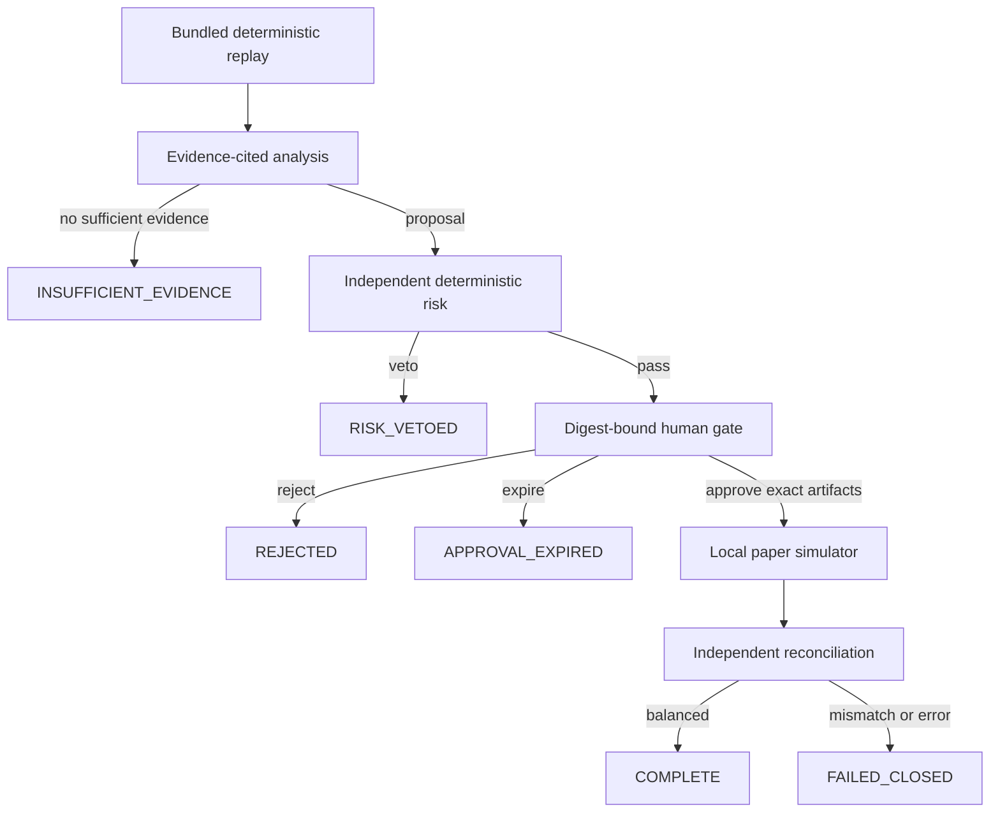

# ADR-0001: Use a bounded, event-sourced, paper-only replay loop

**Date:** 2026-08-09

**Status:** Accepted
**Deciders:** Project maintainer

## Context

A trading-themed workflow can create outsized harm if a proposal is treated as permission, safety checks are retryable obstacles, or a demo-only mode shares a path with live execution. This MVP must be reproducible and auditable while showing useful workflow design without broker access, credentials, real money, financial advice, or a profit claim. It also needs to stop safely when evidence, risk, approval, budget, execution, or reconciliation requirements are not satisfied.

## Decision

RiskLedger uses a finite, bounded workflow over bundled replay data: state comes from an append-only, optimistically versioned event stream; work is capped by steps, retries, active elapsed time, and cost units; and human approval uses a session-locked TTL that defaults to 15 minutes.

The analyzer, deterministic risk engine, human gate, local paper simulator, and independent reconciler have separate authority: only `AWAITING_APPROVAL` accepts a human decision, approval must match the server-issued artifact digest and expected event-stream version, and a human can reject a risk pass but cannot override a veto.

The bundled-scenario risk policy is owned by the server and is not part of the create-session
request. Unknown request fields—including `risk_limits`—fail closed rather than creating a
session under caller-selected constraints.

The repository contains only a local simulator, with no broker adapter, live hostname, credential field, real-money mode, or network market-data dependency.

## Decision flow

## Invariants

- A fill implies a recorded risk pass and an unexpired human approval whose digest and version match exactly.
- A veto, rejection, expiry, insufficient-evidence result, or pre-execution closed failure implies zero fills.
- A reconciliation failure may retain a simulated fill as audit evidence but cannot reach `COMPLETE` or trigger further execution.
- Risk evaluation is pure, deterministic, and unable to modify a proposal or policy.
- Humans may reject a pass; they may not approve a veto.
- Analysis bars do not cross the scenario's decision time; proposal logic reads no values from the later execution bar.
- Paper execution uses exact decimal arithmetic and no external execution venue.
- Reconciliation recomputes expected cash and position independently from the executor's projection.
- Events have contiguous sequence numbers and payload hash links; tampering fails verification and stale expected versions fail instead of overwriting history.
- Exceeding any work budget stops closed; the workflow never responds by weakening policy or retrying indefinitely.
- Terminal sessions do not automatically return to an actionable state.

## Alternatives considered

### Alternative 1: Continuous autonomous trading loop

- **Pros:** More visually dynamic and closer to a production trading service.
- **Cons:** Creates unbounded behavior, pressure to generate trades, external-data dependence, and materially higher operational and regulatory risk.
- **Why not:** The portfolio objective is to demonstrate controllable software behavior, not autonomous capital allocation. A safe no-trade stop must count as success.

### Alternative 2: Put risk logic inside the proposal generator

- **Pros:** Fewer components and a shorter request path.
- **Cons:** The component rewarded for producing a proposal would also judge its safety; threshold behavior would be harder to reproduce and test.
- **Why not:** Risk needs an independent, deterministic veto that cannot be negotiated or regenerated away.

### Alternative 3: Store one mutable session document

- **Pros:** Simple CRUD implementation and compact reads.
- **Cons:** Loses decision provenance, makes stale writes easier, and obscures whether approval preceded execution.
- **Why not:** Ordered events and optimistic versions make the safety sequence observable and enforceable. A projection still provides convenient reads.

### Alternative 4: Approve by session or proposal ID only

- **Pros:** Simpler UI payload and fewer conflicts.
- **Cons:** A human decision could survive a changed proposal, policy result, portfolio snapshot, or stream state.
- **Why not:** Approval is meaningful only for the exact artifacts reviewed, for a bounded time.

### Alternative 5: Keep a disabled live-broker adapter for future use

- **Pros:** Makes a later integration appear easier.
- **Cons:** A configuration error could cross the paper/live boundary; credentials and network behavior would enter the threat model immediately.
- **Why not:** The safest boundary is structural absence. Any future live system requires separate threat modeling, compliance review, idempotency design, and a superseding ADR.

## Consequences

### Positive

- Replays and safety decisions are reproducible from locked inputs.
- Veto, abstention, rejection, and expiry are explicit, inspectable no-trade outcomes.
- Human intent is narrow, time-bound, and resistant to stale or altered artifacts.
- Event history supports an understandable audit timeline and projection rebuild.
- Independent reconciliation catches accounting defects or tampering before completion.
- The demo runs offline without secrets or paid infrastructure.

### Negative

- The deterministic analyzer and synthetic fixtures do not model real market uncertainty.
- An in-process event store is not durable and cannot coordinate multiple workers.
- A strict digest/version contract can require a reviewer to re-read and re-approve after any material change.
- Hard stops favor safety over availability and may require manual investigation.

### Risks

- **Risk:** Future contributors accidentally imply live readiness or profitability.
  **Mitigation:** Keep permanent paper-only disclosures, explicit limitations, and tests asserting simulated fills.
- **Risk:** Event sourcing is mistaken for durable audit storage.
  **Mitigation:** Document the in-memory limitation and require a transactional append-only store before any hosted multi-process use.
- **Risk:** The UI is mistaken for an authority or production security boundary.
  **Mitigation:** Revalidate digest, version, status, and expiry server-side; describe the custom header as a local CSRF-style guard only.
- **Risk:** Execution and reconciliation share a defect.
  **Mitigation:** Keep reconciliation a separate calculation and test it with intentionally tampered projections.
